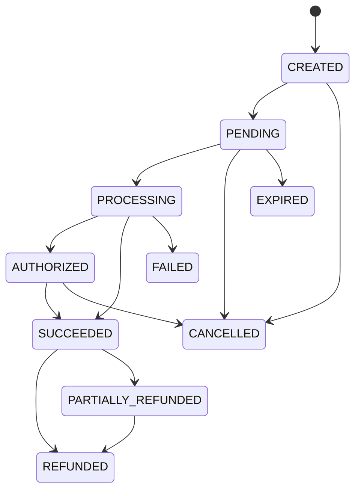

# PAIEMENTS CI / UEMOA & RÉCONCILIATION FINANCIÈRE (PHASE 7)

## 1. Principes et Règle d'Or

> [!CAUTION]
> **RÈGLE ABSOLUE : Zéro faux paiement.**
> Aucun paiement n'est simulé ou considéré comme réussi sans confirmation bancaire ou webhook cryptographiquement authentifié.

Lorsque les identifiants réels de passerelle (ex: Wave CI) ne sont pas configurés dans l'environnement, le système renvoie rigoureusement :
`PAYMENT_PROVIDER_NOT_CONFIGURED` (HTTP 503).

Le mode de règlement hors-ligne officiel (`OfflinePaymentProvider` : virement bancaire BACI / SGCI et transfert direct avec validation administrateur) prend alors le relais sans blocage commercial.

---

## 2. Machine d'État des Paiements (10 Statuts)

### Règles de transition serveur
- Une souscription n'est **JAMAIS** activée au statut `CREATED`, `PENDING` ou `PROCESSING`.
- Seul le statut `SUCCEEDED` déclenche l'activation / réactivation du service d'organisation.
- Les transitions illégales (ex: `CREATED -> SUCCEEDED` direct ou `FAILED -> SUCCEEDED`) sont bloquées avec une exception `INVALID_PAYMENT_STATE_TRANSITION` (HTTP 400).

---

## 3. Configuration des Fournisseurs

| Fournisseur | Code | Devise | Méthodes | Variable d'activation |
|---|---|---|---|---|
| Virement / Chèque CI | `OFFLINE_TRANSFER` | XOF | Virement bancaire, Dépôt direct | Toujours actif |
| Wave Côte d'Ivoire | `WAVE_CI` | XOF | Mobile Money, Cartes | `PAYMENT_PROVIDER_ENABLED=true` |
| Orange Money CI | `ORANGE_MONEY_CI` | XOF | Mobile Money | Prévu pour Phase 8 |
| MTN MoMo CI | `MTN_MOMO_CI` | XOF | Mobile Money | Prévu pour Phase 8 |

---

## 4. Sécurité des Webhooks & Anti-Rejeu

- **Signature HMAC-SHA256** : L'en-tête `x-wave-signature` (ou `x-signature`) est validé avec le secret partagé (`PAYMENT_WEBHOOK_SECRET`). En cas d'incohérence, rejet immédiat `401 Unauthorized`.
- **Protection Anti-Rejeu** : Tout webhook dont l'horodatage `timestamp` dévie de plus de 300 secondes (5 minutes) par rapport à l'heure serveur est immédiatement rejeté avec le code `REPLAY_ATTACK_DETECTED` (HTTP 400).
- **Idempotence** : Chaque paire `provider + event_id` est mémorisée. La réception répétée d'un même événement renvoie `ALREADY_PROCESSED` sans double impact sur la comptabilité.

---

## 5. Réconciliation Financière

Le service `PaymentReconciliationService` analyse en continu les écarts entre les factures, les transactions et les encaissements réels :
- **`DUPLICATE_TRANSACTION`** : Même identifiant de transaction utilisé sur plusieurs factures.
- **`PAYMENT_WITHOUT_INVOICE`** : Transaction orpheline sans facture rattachée.
- **`AMOUNT_MISMATCH`** : Écart entre le montant attendu de la facture et le montant encaissé.
- **`CURRENCY_MISMATCH`** : Transaction reçue dans une devise différente de la facture (ex: EUR au lieu de XOF).
