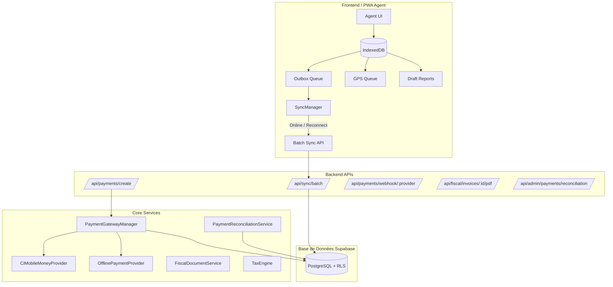

# SECURIA — ARCHITECTURE PHASE 7 (v2.7.0)

## 1. Vue d'Ensemble

La Phase 7 de SECURIA transforme la plateforme en introduisant trois piliers stratégiques sans régression sur les Phases 1 à 6 :
1. **Paiements Réels CI / UEMOA (Bloc A)** : Abstraction multi-fournisseurs avec passerelle Wave / Mobile Money, règle stricte *Zero Fake Payment*, machine d'état à 10 statuts, protection anti-rejeu et réconciliation financière.
2. **Facturation Fiscale & Documentaire (Bloc B)** : Moteur de calcul TVA (18% en Côte d'Ivoire), verrouillage immuable avec scellé cryptographique SHA-256, émission d'avoirs (Credit Notes) et génération de PDF fiscaux avec statut de validation transparent (*"Configuration fiscale en attente de validation réglementaire"*).
3. **Agent Offline-First & Synchronisation Résiliente (Bloc C)** : PWA complète avec Service Worker dédié, base structurée locale IndexedDB (`securia_agent_db`), mécanisme Outbox, détection automatique de connectivité, synchronisation par lot (`/api/sync/batch`), retry exponentiel, gestion des conflits et purge sécurisée au logout.

---

## 2. Diagramme des Composants

---

## 3. Schéma de Données Phase 7

La migration `20260930500000_phase7_payments_fiscal_offline.sql` a étendu la base sans recréer de tables superflues :
- **`invoices`** : Ajout de `invoice_type`, `is_immutable`, `fiscal_seal`, `original_invoice_id`, `company_rccm`, `company_ncc`, `annulment_reason`, `version`.
- **`payment_transactions`** : Enregistrement de chaque tentative de paiement (10 états, XOF, indexé par organisation et facture).
- **`payment_webhook_events`** : Journalisation et protection contre le rejeu de webhooks (unicité `provider + event_id`).
- **`offline_sync_events`** : Table d'idempotence des synchronisations offline (unicité `client_event_id`).
- **`fiscal_configurations`** : Paramétrage fiscal multi-organisationnel (taux TVA, mentions légales, statut d'homologation).
