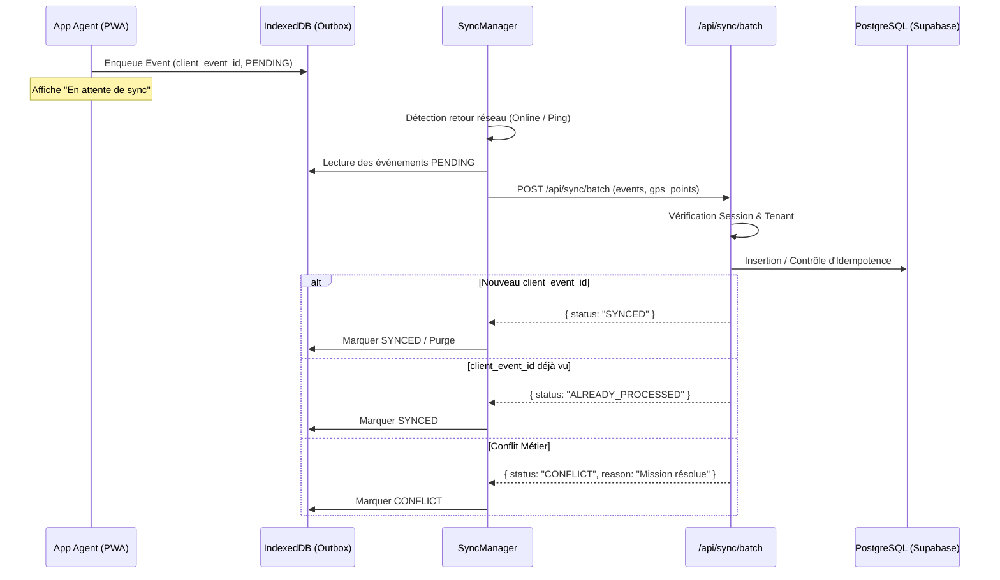

# PROTOCOLE DE SYNCHRONISATION & OUTBOX PATTERN (PHASE 7)

## 1. Cycle de Vie de l'Outbox



---

## 2. Format du Lot de Synchronisation (`/api/sync/batch`)

### Requête entrante (Client vers Serveur)
```json
{
  "events": [
    {
      "client_event_id": "evt-1790812345-abc12",
      "entity_type": "INTERVENTION_STATUS",
      "entity_id": "int-fa01-002",
      "operation": "ARRIVED",
      "payload": {
        "timestamp": "2026-09-30T22:30:00.000Z",
        "latitude": 5.3488,
        "longitude": -4.0274,
        "accuracy": 7.5
      },
      "created_at": "2026-09-30T22:30:02.100Z"
    }
  ],
  "gps_points": [
    {
      "latitude": 5.3488,
      "longitude": -4.0274,
      "accuracy": 7.5,
      "timestamp": 1790812345000,
      "source": "DEVICE_HARDWARE"
    }
  ]
}
```

### Réponse serveur (Serveur vers Client)
```json
{
  "success": true,
  "processedCount": 1,
  "results": {
    "evt-1790812345-abc12": {
      "status": "SYNCED",
      "serverEventId": "evt_srv_1790812348"
    }
  },
  "gpsSyncedCount": 1
}
```

---

## 3. Stratégie de Retry Exponentiel

En cas d'échec réseau ou d'erreur serveur transitoire (503 / 504), le `SyncManager` applique les intervalles de rétraction suivants :
1. Tentative 1 : **5 secondes**
2. Tentative 2 : **15 secondes**
3. Tentative 3 : **30 secondes**
4. Tentative 4 : **60 secondes**
5. Tentative 5+ : **300 secondes (5 minutes)**

Le nombre de tentatives (`retry_count`) est consigné dans chaque entrée de l'Outbox.
