# 🛡️ RAPPORT D'AUDIT GLOBAL & ÉTAT DE L'ART — PLATEFORME SECURIA MVP

**Date de l'audit :** 29 septembre 2026  
**Version logicielle :** SECURIA MVP v1.0.0 (Production)  
**Environnement Hébergement :** Netlify Production ([securia-pilot.netlify.app](https://securia-pilot.netlify.app))  
**Base de données & Auth :** Supabase PostgreSQL (`gwxchazcuosajziampvk.supabase.co`)  
**Statut de compilation :** ✅ `next build` — 31/31 routes compilées sans avertissement ni erreur TypeScript  

---

## 1. Synthèse Exécutive

La plateforme **SECURIA** est une solution complète de télésurveillance, d'intervention d'urgence et de gestion de sécurité privée conçue pour interconnecter en temps réel :
1. **Les Clients particuliers et entreprises (`USER`)** : déclenchement d'alerte panique SOS immédiate, géolocalisation d'urgence, gestion de sites protégés et contacts d'urgence.
2. **Les Agents de patrouille sur le terrain (`AGENT`)** : console mobile dédiée, diffusion télémétrique GPS en direct, statut de service (`ON_DUTY` / `OFF_DUTY`), acceptation/refus de missions, navigation vers l'incident et saisie de rapports de fin de mission avec checklist de vérification périmétrique.
3. **Le Centre Opérationnel de Sécurité / Dispatch (`SECURITY_MANAGER`)** : tour de contrôle en temps réel, sirènes audio synthétisées par Web Audio API, cartographie interactive Leaflet des incidents et agents actifs, affectation manuelle/automatique, escalade et consultation des rapports d'intervention.
4. **L'Administration Générale (`ADMIN`)** : supervision système, gestion intégrale des comptes (visualisation, recherche, filtrage, suppression unitaire, purge globale de test avec libération immédiate des adresses email dans `auth.users`) et consultation centralisée de tous les rapports de mission.

---

## 2. Architecture Technique & Flux de Données

```mermaid
flowchart TD
    subgraph Client ["Clients (Web & Mobile PWA)"]
        UI_User["Dashboard Client / PanicButton"]
        UI_Site["Gestion Sites & Contacts"]
    end

    subgraph Agent ["Agents Terrain (Console Mobile)"]
        UI_Agent["Console Agent / Duty Toggle"]
        GPS_Agent["Balise GPS Temps Réel (WatchPosition)"]
        Report_Agent["Rapports de Fin de Mission"]
    end

    subgraph Dispatch ["SOC & Dispatcher"]
        UI_Dispatch["Console SOC / Map Leaflet"]
        Audio_Sirens["Sirènes Web Audio Oscillators"]
        Assign_Modal["Affectation Agent & Escalade"]
    end

    subgraph Admin ["Console Administrateur"]
        UI_Admin_Users["Gestion & Suppression Comptes"]
        UI_Admin_Reports["Centralisation Rapports Missions"]
        UI_Admin_Health["Télémétrie Système"]
    end

    subgraph Backend ["Next.js 16 App Router (Netlify Serverless)"]
        API_Alerts["/api/alerts & /api/alerts/[id]"]
        API_Location["/api/agent/location & /api/agent/duty-status"]
        API_Admin["/api/admin/users"]
        API_Interventions["/api/interventions"]
        Auth_Guard["api-guard & Bearer Token JWT"]
    end

    subgraph Supabase ["Supabase Cloud Platform (gwxchazcuosajziampvk)"]
        Auth_Users["auth.users (Identifiants & Tokens)"]
        DB_Public["PostgreSQL Public Schema (RLS Active)"]
        Admin_SDK["supabaseAdmin (Service Role Key Privilégiée)"]
    end

    UI_User -->|Déclenchement SOS + GPS| API_Alerts
    GPS_Agent -->|Ping GPS 15s| API_Location
    Report_Agent -->|Clôture + Rapport| API_Interventions
    UI_Dispatch -->|Supervision + Affectation| API_Alerts
    UI_Admin_Users -->|Visualisation & Purge| API_Admin

    API_Alerts --> DB_Public
    API_Location --> DB_Public
    API_Interventions --> DB_Public
    API_Admin -->|Nettoyage en cascade| DB_Public
    API_Admin -->|auth.admin.deleteUser| Auth_Users
    Admin_SDK --> Auth_Users
    Admin_SDK --> DB_Public
```



---

## 3. Matrice d'Audit des Fonctionnalités par Rôle

| Rôle | Module / Fonctionnalité | Description Opérationnelle | Statut |
| :--- | :--- | :--- | :---: |
| **USER** | **Déclenchement Panique (SOS)** | Bouton hold/click avec compte à rebours 5s, annulation de sécurité, capture géolocalisée et transmission instantanée. | ✅ Validé |
| **USER** | **Suivi d'Alerte en Temps Réel** | Page `/alert/[id]` avec polling 4s, statut de l'intervention (`ACKNOWLEDGED`, `ASSIGNED`, `EN_ROUTE`, `ON_SITE`, `RESOLVED`), identité de l'agent et numéro d'urgence. | ✅ Validé |
| **USER** | **Sites Protégés & Contacts** | Déclaration de domiciles/bureaux, consignes d'accès, codes portail, contacts prévenus en cascade. | ✅ Validé |
| **AGENT** | **Statut de Service (Prise de poste)** | Switch `ON_DUTY` / `OFF_DUTY`, auto-provisioning en base si profil manquant, affichage des matricules et véhicules. | ✅ Validé |
| **AGENT** | **Télémétrie GPS Automatique** | Envoi régulier des coordonnées réelles (lat/lng) via `/api/agent/location` pour géolocalisation SOC. | ✅ Validé |
| **AGENT** | **Acceptation & Navigation Mission** | Notification visuelle d'alerte, acceptation en 1 clic, guidage GPS vers les coordonnées du site/client. | ✅ Validé |
| **AGENT** | **Rapport de Fin de Mission** | Saisie obligatoire du compte-rendu, checklist des vérifications (accès, périmètre, contact client) et clôture horodatée. | ✅ Validé |
| **DISPATCH** | **Tour de Contrôle SOC (`/dispatch`)** | Vue d'ensemble des alertes en cours, son d'alerte Web Audio (synthétiseur autonome), temps d'attente et criticité. | ✅ Validé |
| **DISPATCH** | **Cartographie Interactive Leaflet** | Tracé géographique des sites, alertes actives et agents en patrouille (`/dispatch/map`), mise à jour en temps réel. | ✅ Validé |
| **DISPATCH** | **Affectation & Escalade** | Attribution manuelle ou auto des agents disponibles les plus proches, notification push/in-app, protocole d'escalade. | ✅ Validé |
| **DISPATCH** | **Affichage du Rapport d'Intervention** | Restitution du rapport officiel d'agent sur `/dispatch/alerts/[id]` et sur le feed d'alertes résolues. | ✅ Validé |
| **ADMIN** | **Supervision des Comptes Utilisateurs** | Liste de tous les comptes (Clients, Agents, Coordinateurs, Admins), recherche instantanée, filtres par rôle. | ✅ Validé |
| **ADMIN** | **Suppression de Compte & Purge Test** | Suppression atomique unitaire ou globale, cascade DB + suppression dans `auth.users`, libération immédiate des emails. | ✅ Validé |
| **ADMIN** | **Consultation des Rapports de Mission** | Onglet dédié centralisant tous les rapports d'intervention terminés avec badges agents, véhicules et horodatages. | ✅ Validé |
| **ADMIN** | **Protection Anti-Auto-Suppression** | Verrouillage formel interdisant à l'administrateur connecté de supprimer son propre compte (`ahossancedric22@gmail.com`). | ✅ Validé |

---

## 4. Historique des Défis Résolus & Corrections Majeures

### Défi 1 : Cartographie SOC & Visibilité des Agents
- **Problème rencontré :** Les agents n'apparaissaient pas sur la carte du Dispatch (`/dispatch/map`) bien qu'étant connectés.
- **Cause :** Manque d'initialisation de ligne dans `security_agents` lors de la connexion initiale de l'agent, et format de coordonnées non harmonisé entre le GPS mobile et Leaflet.
- **Résolution :**
  - Ajout de l'auto-provisioning d'agent dans [`/api/agent/duty-status`](file:///c:/Users/HP%20ELTEBOO/Desktop/Securia/src/app/api/agent/duty-status/route.ts).
  - Normalisation des coordonnées de télémétrie dans [`/api/dispatch/map-data`](file:///c:/Users/HP%20ELTEBOO/Desktop/Securia/src/app/api/dispatch/map-data/route.ts).
  - Hook de géolocalisation avec fallback sécurisé pour tests et production.

### Défi 2 : Authentification Client (Erreurs 401/403 RLS)
- **Problème rencontré :** Plusieurs appels API (`/api/alerts`, `/api/interventions`) échouaient ou retournaient un tableau vide côté client lors de consultations par les agents ou dispatchers.
- **Cause :** Utilisation de `fetch` standard natif sans en-tête `Authorization: Bearer <session_token>`.
- **Résolution :**
  - Remplacement systématique par `authFetch` ou injection manuelle du token de session Supabase dans les en-têtes HTTP de tous les dashboards (`src/lib/api/auth-fetch.ts`).
  - Utilisation de `getScopedDatabaseClient(req)` dans les routes API pour respecter strictement le contexte RLS de l'utilisateur authentifié.

### Défi 3 : Invisibilité des Rapports de Fin de Mission
- **Problème rencontré :** L'utilisateur a signalé que les rapports rédigés par les agents en fin de mission n'arrivaient ni au Dispatch ni chez l'Administrateur.
- **Cause :** L'enregistrement en base PostgreSQL fonctionnait correctement (`alerts.resolution_report` et `interventions.report`), mais **aucun composant visuel ne les affichait** dans les pages du Dispatch ou de l'Admin.
- **Résolution :**
  - Ajout d'une carte officielle **« Rapport Officiel de Fin de Mission »** dans [`/dispatch/alerts/[id]`](file:///c:/Users/HP%20ELTEBOO/Desktop/Securia/src/app/(dispatch)/dispatch/alerts/[id]/page.tsx).
  - Intégration d'un encadré de prévisualisation dans [`AlertFeedCard`](file:///c:/Users/HP%20ELTEBOO/Desktop/Securia/src/components/dispatch/AlertFeedCard.tsx) et d'un onglet **« Rapports de Mission »** sur [`/dispatch`](file:///c:/Users/HP%20ELTEBOO/Desktop/Securia/src/app/(dispatch)/dispatch/page.tsx).
  - Création d'un onglet complet **« Rapports de Fin de Mission »** dans la console [`/admin`](file:///c:/Users/HP%20ELTEBOO/Desktop/Securia/src/app/(admin)/admin/page.tsx) listant l'ensemble des interventions terminées.

### Défi 4 : Suppression des Comptes & Conflits d'Emails Réinscrits
- **Problème rencontré :** Impossible de supprimer un compte utilisateur de test pour retester l'inscription avec le même email (*"User already registered"* ou blocage par clés étrangères PostgreSQL).
- **Cause :** 
  - Les contraintes de clés étrangères (`ON DELETE RESTRICT`) bloquaient la suppression dans `public.users`.
  - Même si la ligne était supprimée dans `public.users`, le compte restait inscrit dans la table interne `auth.users` de Supabase, qui exige des droits de superutilisateur (`service_role`).
- **Résolution :**
  - Intégration de la clé secrète **`SUPABASE_SERVICE_ROLE_KEY`** dans [`.env.local`](file:///c:/Users/HP%20ELTEBOO/Desktop/Securia/.env.local) et sur Netlify Production.
  - Implémentation du nettoyage relationnel en cascade ordonné dans [`/api/admin/users`](file:///c:/Users/HP%20ELTEBOO/Desktop/Securia/src/app/api/admin/users/route.ts).
  - Appel direct à `supabaseAdmin.auth.admin.deleteUser(id)` pour supprimer définitivement le compte d'authentification et libérer immédiatement l'adresse email.
  - Validation par test réel : création, suppression et réinscription immédiate d'un email de test sans aucune erreur.

---

## 5. Audit de Sécurité & Robustesse

```
+-----------------------------------------------------------------------------------+
|                            POSTURE DE SÉCURITÉ SECURIA                            |
+-----------------------------------------------------------------------------------+
| [x] RLS (Row Level Security) active sur toutes les tables sensibles               |
| [x] Protection Anti-IDOR stricte (validation propriétaire / rôle sur chaque API)  |
| [x] Clé publique anon_key restreinte aux droits utilisateurs                      |
| [x] Clé service_role confinée exclusivement au backend serveur (non exposée)      |
| [x] Sanitarisation des entrées et typage strict TypeScript                        |
| [x] Idempotence des déclenchements SOS (anti-rebond 30s)                          |
| [x] Protection absolue du compte Super-Admin contre l'auto-suppression            |
| [x] Traçabilité d'audit dans la table audit_logs                                 |
+-----------------------------------------------------------------------------------+
```

---

## 6. Inventaire des Fichiers Clés du Projet

| Périmètre | Fichier Source | Rôle Principal |
| :--- | :--- | :--- |
| **Admin** | [`src/app/(admin)/admin/page.tsx`](file:///c:/Users/HP%20ELTEBOO/Desktop/Securia/src/app/(admin)/admin/page.tsx) | Console d'administration (Comptes, Rapports, Télémétrie) |
| **Admin API** | [`src/app/api/admin/users/route.ts`](file:///c:/Users/HP%20ELTEBOO/Desktop/Securia/src/app/api/admin/users/route.ts) | API GET / DELETE pour gestion et purge des utilisateurs |
| **Dispatch** | [`src/app/(dispatch)/dispatch/page.tsx`](file:///c:/Users/HP%20ELTEBOO/Desktop/Securia/src/app/(dispatch)/dispatch/page.tsx) | Tour de contrôle SOC et liste des alertes / rapports |
| **Dispatch Detail** | [`src/app/(dispatch)/dispatch/alerts/[id]/page.tsx`](file:///c:/Users/HP%20ELTEBOO/Desktop/Securia/src/app/(dispatch)/dispatch/alerts/[id]/page.tsx) | Fiche détaillée d'intervention & Rapport de fin de mission |
| **Dispatch Map** | [`src/app/(dispatch)/dispatch/map/page.tsx`](file:///c:/Users/HP%20ELTEBOO/Desktop/Securia/src/app/(dispatch)/dispatch/map/page.tsx) | Cartographie temps réel Leaflet (alertes, sites, agents) |
| **Agent UI** | [`src/app/(agent)/agent/page.tsx`](file:///c:/Users/HP%20ELTEBOO/Desktop/Securia/src/app/(agent)/agent/page.tsx) | Console de bord agent mobile (Prise de poste, GPS, Missions) |
| **Agent API** | [`src/app/api/agent/location/route.ts`](file:///c:/Users/HP%20ELTEBOO/Desktop/Securia/src/app/api/agent/location/route.ts) | Endpoint de mise à jour des coordonnées GPS de patrouille |
| **Client UI** | [`src/app/(client)/dashboard/page.tsx`](file:///c:/Users/HP%20ELTEBOO/Desktop/Securia/src/app/(client)/dashboard/page.tsx) | Tableau de bord client avec déclenchement Panique SOS |
| **Auth & Guard** | [`src/lib/security/api-guard.ts`](file:///c:/Users/HP%20ELTEBOO/Desktop/Securia/src/lib/security/api-guard.ts) | Contrôle d'accès RBAC et validation des tokens JWT Bearer |
| **Admin Client** | [`src/lib/supabase/admin.ts`](file:///c:/Users/HP%20ELTEBOO/Desktop/Securia/src/lib/supabase/admin.ts) | Client Supabase privilégié avec `service_role` |
| **Migrations** | [`supabase/migrations/`](file:///c:/Users/HP%20ELTEBOO/Desktop/Securia/supabase/migrations/) | Scripts DDL PostgreSQL, RLS et procédures stockées |
| **Déploiement** | [`scripts/deploy-to-netlify.js`](file:///c:/Users/HP%20ELTEBOO/Desktop/Securia/scripts/deploy-to-netlify.js) | Script de compilation et déploiement automatisé Netlify CLI |

---

## 7. État Actuel & Disponibilité en Production

- **URL de production live :** [https://securia-pilot.netlify.app](https://securia-pilot.netlify.app)
- **Compte Super-Administrateur vérifié :** `ahossancedric22@gmail.com`
- **Toutes les fonctionnalités requises sont opérationnelles et testées de bout en bout.**
